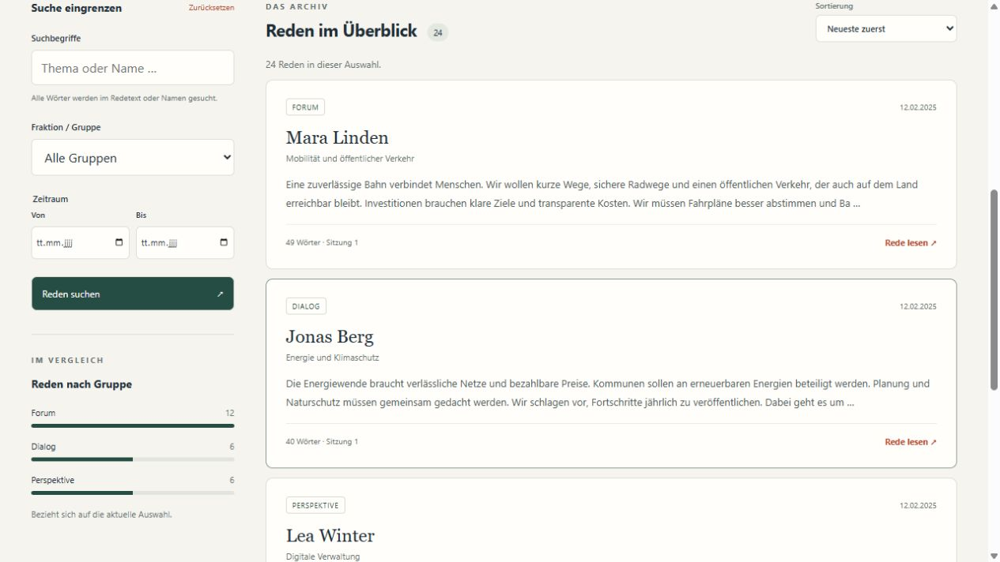

# Parliament Explorer

A local reading and search interface for parliamentary speeches. Find a topic, narrow a debate by date or faction, and read speeches alongside their source metadata and interjections.

**Java 21 · SQLite full-text search · No accounts or external services**



## Try the demo

Install Java 21 **JDK** and Maven. On Ubuntu / WSL:

```bash
sudo apt install openjdk-21-jdk-headless maven
mvn verify
java -jar target/parliament-explorer.jar --demo
```

Open **http://127.0.0.1:7070/** in your browser. Stop the application with Ctrl+C. If the port is occupied, add `--port 7080`.

The demo contains 24 fictional speeches, four fictional speakers and three fictional groups. A visible banner distinguishes it from real records. No database setup is needed: the demo uses a temporary SQLite file, removed on normal JVM shutdown. Maven needs internet access on the first build; the packaged application and its frontend run offline.

## Explore a real corpus

Create a database with [Parliament Corpus](https://github.com/FinnFFM/parliament-corpus), then open it:

```bash
java -jar target/parliament-explorer.jar --db /absolute/path/to/corpus.db
```

The explorer opens the database **read-only** and checks its schema version. It never imports or modifies speeches. Stop it during corpus updates and restart afterward.

## Features

- Indexed full-text search across speech text and speaker names.
- Faction and inclusive date-range filters.
- Newest, oldest and longest-first sorting with stable pagination.
- Statistics and group comparisons that follow the current filters.
- A readable speech view with paragraph breaks, interjections and source references.
- Plain-text download and browser printing / save-as-PDF.
- Responsive layout, keyboard-accessible controls and a native dialog.
- A small read-only JSON API for local tools.

All search words must match. Search is case-insensitive and uses SQLite's Unicode tokenizer with diacritic normalization; it does not support stemming, prefix search or arbitrary FTS query syntax. Filter state is stored in the page URL so searches can be bookmarked. Faction labels and names are displayed as recorded in the source.

The interface is in German; setup documentation is in English. Fonts, scripts and styles are bundled or system-provided. There are no CDN dependencies, analytics or background downloads.

## API

| Endpoint | Result |
| --- | --- |
| `GET /api/meta` | Demo flag and corpus schema version |
| `GET /api/factions` | Available faction labels |
| `GET /api/speeches` | Paginated speech summaries |
| `GET /api/stats` | Filtered totals, groups and monthly counts |
| `GET /api/speech?id=…` | Complete speech, comments and source metadata |

The list and statistics endpoints accept `q`, `faction`, `from` and `to` (`YYYY-MM-DD`). Lists also accept `page` (starting at 1) and `sort` (`newest`, `oldest`, `longest`). Pages contain up to 20 speeches. Invalid parameters return HTTP 400; missing speeches return 404. Search values are passed through parameterized SQL and displayed as text, not executable HTML.

```bash
curl 'http://127.0.0.1:7070/api/speeches?q=Energiewende&page=1'
```

The server binds only to `127.0.0.1`. It is intended for local use, not unauthenticated public hosting. In WSL, use Windows localhost forwarding or a browser within the same environment if localhost is not forwarded.

## Development and scope

```bash
mvn verify
```

Tests cover search, combined filters, date validation, pagination, missing records, SQL-like input, schema checks, HTTP status codes and frontend delivery. GitHub Actions runs the Java 21 build.

This release focuses on dependable corpus browsing. It does not run the earlier experimental remote NLP, speech-recognition or video-download pipelines, and it does not present inferred sentiment or topics as measured data. PDF output uses the browser's print dialog, so no LaTeX installation is required.

See [the shared database contract](docs/schema.md) and [credits](CREDITS.md). Maintained by Finn Karstens.
